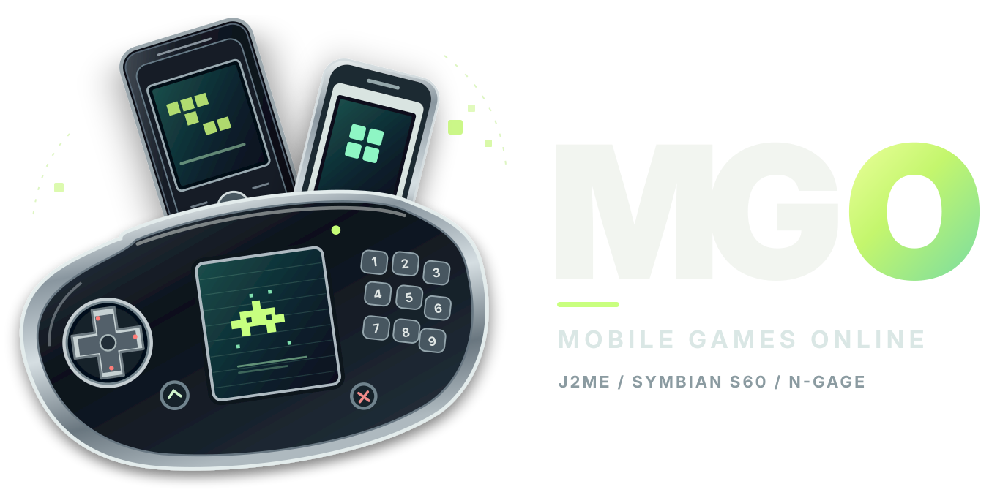
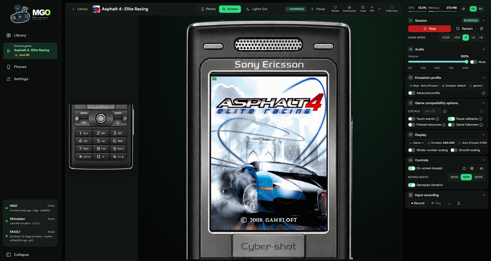
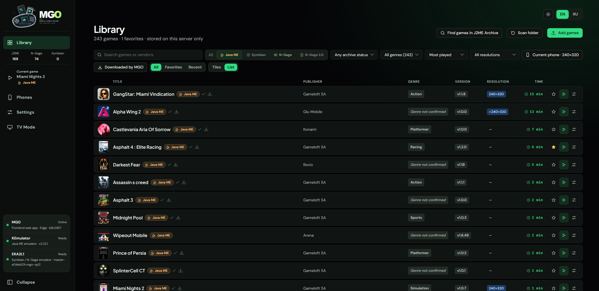
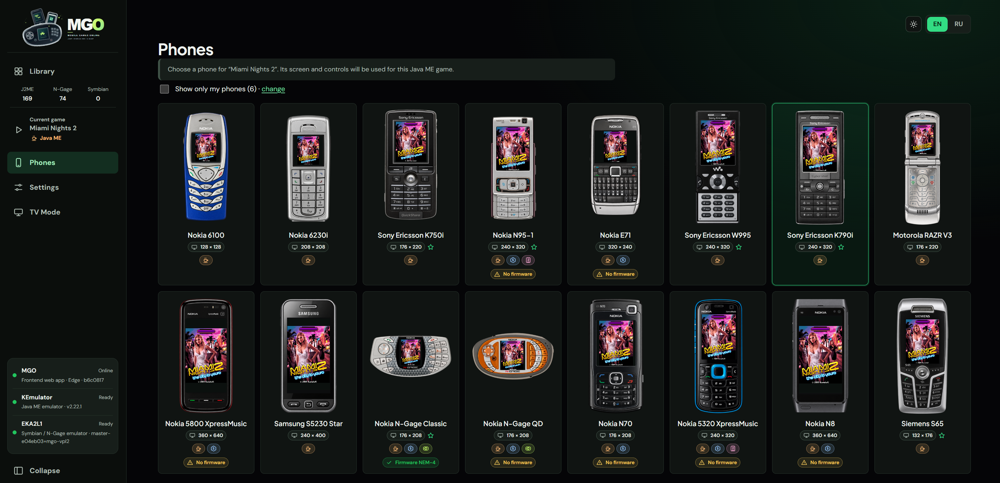
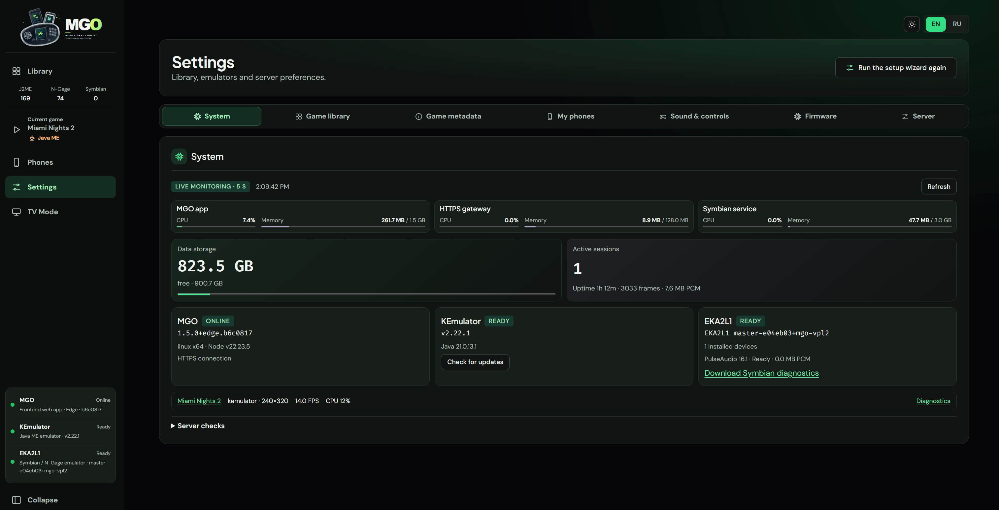
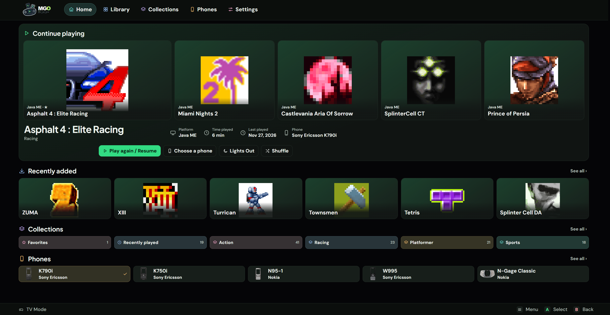
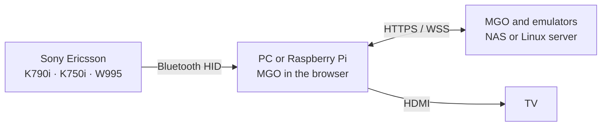

<div align="center">
  <picture>
    <source media="(prefers-color-scheme: light)" srcset="apps/web/public/graphics/brand/logo-light.svg">
    
  </picture>

  <h1>Mobile Games Online</h1>

  <p><strong>Your Java ME, Symbian and N-Gage games in a browser, on phones you remember.</strong></p>
  <p>Play on your desktop or TV. Host your library and saves on your own server.</p>

  <p><a href="#quick-start">Quick start</a> · <a href="#tv-mode">TV Mode</a> · <a href="#use-a-sony-ericsson-as-a-controller">Phone as a controller</a> · <a href="https://github.com/grayhex/MGO/releases">Releases</a> · <a href="README.ru.md">Русский</a></p>

  <p><a href="https://github.com/grayhex/MGO/actions/workflows/ci.yml"></a> <a href="LICENSE"></a></p>

  <p></p>
</div>

## What you can do

- **Play on a familiar handset.** Pick from 16 interactive phone skins, from the Siemens S65 to the Nokia N-Gage. See the full handset, zoom into the screen with the original keypad alongside it, or dim the phone in Lights Out.
- **Browse your own collection.** Import separate folders for Java ME, Symbian and N-Gage. Filter by platform, genre or screen resolution, including the resolution of your selected phone. Open a game card for screenshots, version and other details.
- **Find games and fill in their cards.** Identify Java ME builds with J2ME Archive or start a collection from the curated list. Add artwork and descriptions from supported metadata sources. [Curated Java ME list](apps/api/archive-tools/java_curated_top.txt) · [Library guide](docs/LIBRARY.md)
- **Play your way.** Use a keyboard, touch controls, a gamepad or a supported Sony Ericsson phone. Pick a MIDI SoundFont for Java ME and enable rumble on compatible gamepads. Your saves and per-game settings stay on the server.

## Library, phones and settings screenshots

<div align="center">
  
  
  
</div>

## Quick start

**Docker Compose on a NAS or Linux (x86-64)**

```sh
curl -fsSLO https://raw.githubusercontent.com/grayhex/MGO/main/compose.yaml
docker compose up -d
```

In Portainer or a NAS container manager, deploy the same Compose file as a stack. Open `https://<server-address>:8443` on your home network and follow the setup wizard. [Compose file](compose.yaml) · [Docker and NAS](docs/DOCKER.md) · [HTTPS setup](docs/HTTPS.md) · [Proxmox LXC installer](docs/PROXMOX.md)

1. Upload games, connect your existing folders, or start with the curated Java ME library.
2. For Symbian and N-Gage, add compatible firmware in **Settings → Firmware**. The page lists phone models and product codes to help you find the right files. [Firmware guide](docs/SYMBIAN.md)
3. Choose a handset and select **Play**. In the desktop library, click a game's row to open its card.

TV Mode and Sony Ericsson controls are available from 2.0.0. To install a pre-release once its Docker images are published, set `MGO_VERSION` to its release tag in the Compose environment. The default `latest` follows stable releases. [MGO 2.0.0](https://github.com/grayhex/MGO/releases/tag/2.0.0) · [Docker version settings](docs/DOCKER.md#обновление)

## TV Mode

<div align="center">
  
</div>

Open **TV Mode** from the sidebar or go to `/tv` in the browser on the computer connected to your TV. The dashboard puts recent games, favorites, genre collections and phones within reach of a gamepad. Pick **Use this phone** in **Phones** to make that handset your default for new TV launches. Symbian and N-Gage require compatible installed firmware for the chosen handset.

| Display | What you see |
| --- | --- |
| **Phone** | The full handset and its controls against a black background |
| **Lights Out** | A dimmed handset with the LCD at full brightness |
| **Game only** | The game image on black, with optional whole-number scaling |

Use the D-pad or left stick to move, **A** to select and **B** to go back. The right stick scrolls the library one screen at a time. During a game, **Start / Menu** opens the TV menu. It pauses games that support pausing and lets you change the view, adjust the volume or mute audio without losing the volume setting. [TV Mode and Raspberry Pi guide](docs/TV_MODE.md)

The default in-game layout maps **A** to `5`, the D-pad to `2/4/6/8`, and **LB/RB** to the phone's left and right soft keys. [Gamepad controls](docs/PLAYER_CONTROLS.md#gamepads)

## Use a Sony Ericsson as a controller

Use the buttons on a **K790i**, **K750i** or **W995** to play. The phone sends Bluetooth HID keyboard events to the computer running the browser. In TV Mode, use the gamepad or keyboard to browse the library, then pick up the phone when the game starts.



1. Pair the phone in the Bluetooth settings of the **computer running the browser**.
2. In MGO, open **Settings → Sound & controls → Bluetooth phone**. Download the `.hid` file for your model and send it to the handset via Bluetooth file transfer or USB.
3. On the handset, open **Entertainment → Remote Control**, select the MGO profile ending in **A2** and choose the paired computer.
4. Click **Test phone buttons** in MGO and press a key on the handset. Press the handset's volume-up key to show the **SE** badge in **Controls**, then open a game. [Phone profiles and gamepad mappings](docs/PLAYER_CONTROLS.md#sony-ericsson-bluetooth-controllers)


## Built with

- [KEmulator nnmod](https://github.com/shinovon/KEmulator) for Java ME and [EKA2L1](https://github.com/EKA2L1/EKA2L1) for Symbian and N-Gage.
- [J2ME Archive Search](https://github.com/toca-1/new-j2me-software-archive-search) for the Java ME build index, with [J2ME Vault](https://huggingface.co/datasets/M5-Dev/j2me-vault) and [Internet Archive](https://archive.org/details/96x65pixels_j2me) for selected downloads.
- [My Abandonware](https://www.myabandonware.com/), [MobyGames](https://www.mobygames.com/), [All About Symbian](https://allaboutsymbian.com/n-gage-games/original/) and [LaunchBox Games Database](https://gamesdb.launchbox-app.com/) for game information.

[Backups](docs/BACKUP.md) · [Changelog](CHANGELOG.md) · [MIT license](LICENSE)
