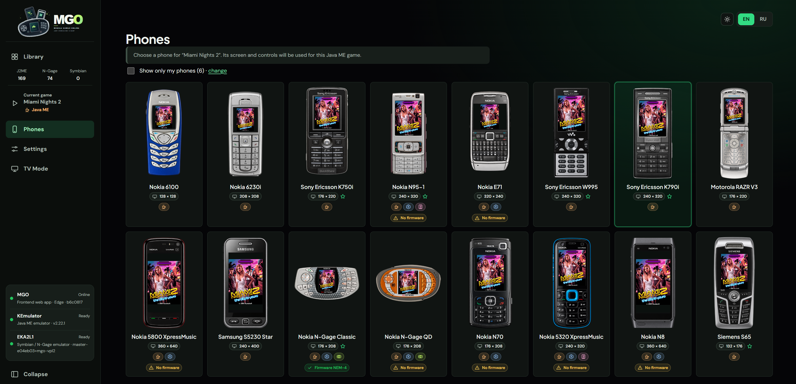

<div align="center">
  <picture>
    <source media="(prefers-color-scheme: light)" srcset="apps/web/public/graphics/brand/logo-light.svg">
    
  </picture>

  <h1>Mobile Games Online</h1>

  <p><strong>Игры Java ME, Symbian и N-Gage в браузере, на экранах телефонов, для которых их выпускали.</strong></p>

  <p>Домашний сервер, NAS или Proxmox · Клавиатура, касания и геймпад · Сохранения на сервере</p>

  <p><a href="https://github.com/grayhex/MGO/releases">Релизы</a> · <a href="docs/DOCKER.md">Docker</a> · <a href="docs/PROXMOX.md">Proxmox</a> · <a href="README.md">English</a></p>

  
</div>

## Возможности

- **Управление как на телефоне.** 16 корпусов с интерактивными кнопками, приближение дисплея и режим «Без света». Можно играть с клавиатурой, геймпадом или сенсорным экраном.
- **Своя библиотека.** Отдельные папки для Java ME, N-Gage и Symbian, поиск и фильтры. В карточке игры видны её версия, разрешение, описание и скриншоты, когда они доступны.
- **Поиск сборок.** Индекс J2ME Archive помогает опознать локальные файлы и найти отдельные JAR из кураторского списка. My Abandonware добавляет описание и скриншоты без ключа API.
- **Сохранения и звук.** Прогресс и настройки хранятся на сервере. Для музыки Java ME можно переключаться между встроенным банком и загруженными SoundFont.

<details>
<summary>Скриншоты библиотеки, телефонов и настроек</summary>





</details>

## Установка

**Docker Compose на NAS или Linux (x86-64)**

```sh
curl -fsSLO https://raw.githubusercontent.com/grayhex/MGO/main/compose.yaml
docker compose up -d
```

В Portainer или менеджере контейнеров NAS разверните тот же файл как стек. Откройте `https://<адрес-сервера>:8443` из домашней сети. [Compose](compose.yaml) · [Установка на NAS](docs/DOCKER.md) · [HTTPS](docs/HTTPS.md)

**Proxmox VE** · Установите MGO в отдельный LXC. [Инструкция](docs/PROXMOX.md)

## Как играть

1. Пройдите мастер настройки и добавьте игры или подключите папки. Коллекцию Java ME можно начать с кураторского списка.
2. Выберите телефон и нажмите Play. Клик по строке откроет карточку игры. В режиме «Экран» дисплей крупнее, а клавиатура телефона видна отдельно.
3. Для Symbian и N-Gage добавьте свою прошивку в **Настройки → Прошивка**. Рядом с формой указаны модели и коды устройств. [Руководство по прошивкам](docs/SYMBIAN.md)

В **ТВ-режиме** можно листать библиотеку, запускать игры и управлять ими с геймпада или телефона. [Руководство по ТВ-режиму и Raspberry Pi](docs/TV_MODE.md)

[Библиотека и сведения об играх](docs/LIBRARY.md) · [Управление](docs/PLAYER_CONTROLS.md) · [Резервные копии](docs/BACKUP.md) · [История изменений](CHANGELOG.md)

## Используемые компоненты

- [KEmulator nnmod](https://github.com/shinovon/KEmulator) для Java ME и [EKA2L1](https://github.com/EKA2L1/EKA2L1) для Symbian и N-Gage.
- [J2ME Archive Search](https://github.com/toca-1/new-j2me-software-archive-search) для индекса сборок. Источники отдельных JAR — [J2ME Vault](https://huggingface.co/datasets/M5-Dev/j2me-vault) и [Internet Archive](https://archive.org/details/96x65pixels_j2me).
- [My Abandonware](https://www.myabandonware.com/), [MobyGames](https://www.mobygames.com/), [All About Symbian](https://allaboutsymbian.com/n-gage-games/original/) и [LaunchBox Games Database](https://gamesdb.launchbox-app.com/) для сведений об играх.

Код MGO распространяется под [лицензией MIT](LICENSE). У компонентов эмуляторов свои лицензии.
