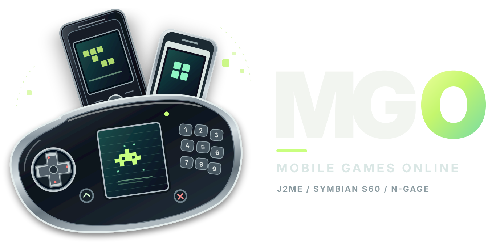
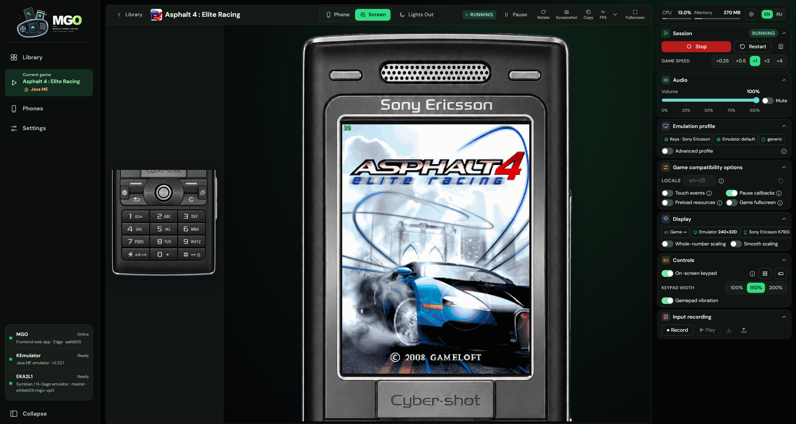
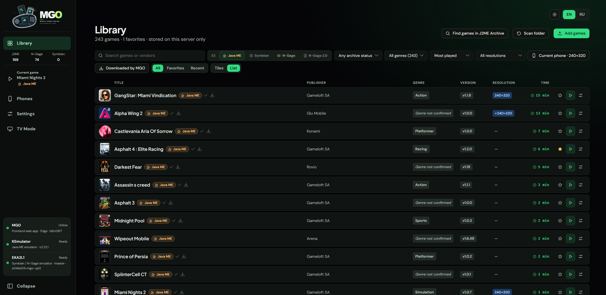
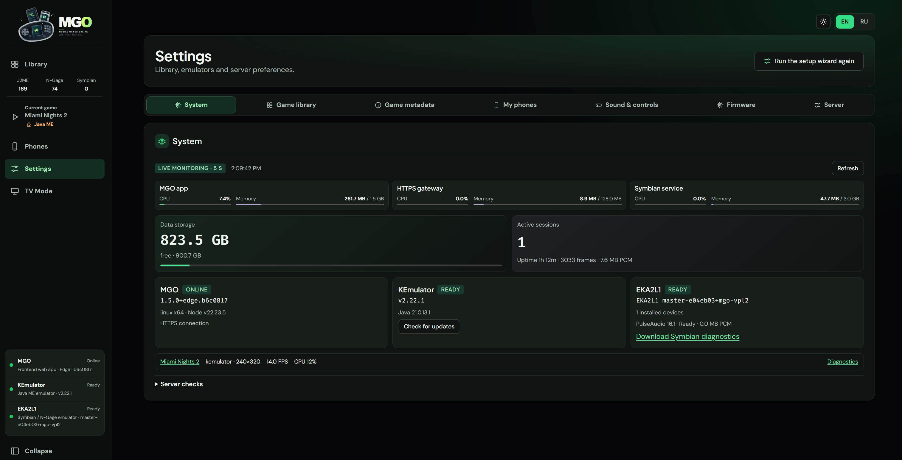
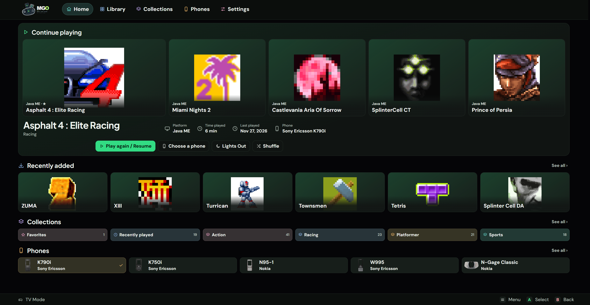
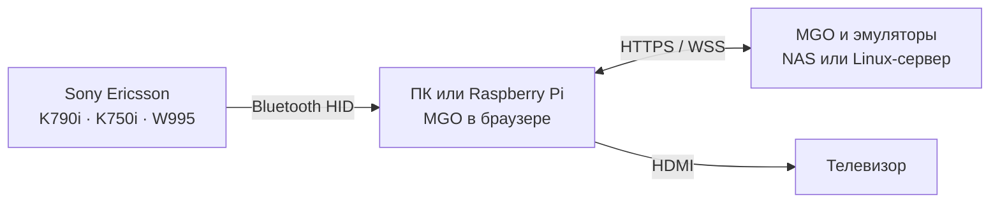

<div align="center">
  <picture>
    <source media="(prefers-color-scheme: light)" srcset="apps/web/public/graphics/brand/logo-light.svg">
    
  </picture>

  <h1>Mobile Games Online</h1>

  <p><strong>Игры Java ME, Symbian и N-Gage в браузере, на экранах знакомых телефонов.</strong></p>
  <p>Играйте за компьютером или на телевизоре. Храните библиотеку и сохранения на своём сервере.</p>

  <p><a href="#быстрый-старт">Быстрый старт</a> · <a href="#тв-режим">ТВ-режим</a> · <a href="#sony-ericsson-как-контроллер">Телефон как контроллер</a> · <a href="https://github.com/grayhex/MGO/releases">Релизы</a> · <a href="README.md">English</a></p>

  <p><a href="https://github.com/grayhex/MGO/actions/workflows/ci.yml"></a> <a href="LICENSE"></a></p>

  <p></p>
</div>

## Возможности

- **Знакомые телефоны.** 16 корпусов с интерактивными кнопками, от Siemens S65 до Nokia N-Gage. Можно показать весь телефон, приблизить экран и вынести родную клавиатуру рядом или приглушить корпус в режиме «Без света».
- **Своя коллекция.** Подключите отдельные папки Java ME, Symbian и N-Gage. Фильтруйте игры по платформе, жанру и разрешению, в том числе под выбранный телефон. В карточках видны скриншоты, версия сборки и другие сведения.
- **Поиск игр и оформление библиотеки.** Определяйте версии через J2ME Archive или начните с кураторского списка. Подключайте источники описаний и изображений. [Кураторский список Java ME](apps/api/archive-tools/java_curated_top.txt) · [Руководство по библиотеке](docs/LIBRARY.md)
- **Удобное управление и звук.** Играйте с клавиатуры, сенсорного экрана, геймпада или совместимого Sony Ericsson. Выбирайте MIDI-банк SoundFont для Java ME и включайте вибрацию на совместимых геймпадах. Сохранения и настройки игр хранятся на сервере.

## Библиотека, телефоны, настройки

<div align="center">
  
  
  
</div>

## Быстрый старт

**Docker Compose на NAS или Linux (x86-64)**

```sh
curl -fsSLO https://raw.githubusercontent.com/grayhex/MGO/main/compose.yaml
docker compose up -d
```

В Portainer или менеджере контейнеров NAS разверните тот же Compose-файл как стек. Откройте `https://<адрес-сервера>:8443` из домашней сети и пройдите мастер настройки. [Compose-файл](compose.yaml) · [Docker и NAS](docs/DOCKER.md) · [Настройка HTTPS](docs/HTTPS.md) · [Установка в Proxmox LXC](docs/PROXMOX.md)

1. Загрузите игры, подключите существующие папки или начните с кураторской библиотеки Java ME.
2. Для Symbian и N-Gage установите совместимую прошивку в **Настройки → Прошивка**. Модели и коды устройств на странице помогут подобрать нужные файлы. [Руководство по прошивкам](docs/SYMBIAN.md)
3. Выберите телефон и нажмите **Играть**. В обычной библиотеке клик по строке игры открывает её карточку.

ТВ-режим и управление с телефона доступны начиная с 2.0.0. Чтобы установить предварительный выпуск после публикации его Docker-образов, укажите его тег в переменной `MGO_VERSION` для Compose. Тег `latest` следует за стабильными релизами. [MGO 2.0.0](https://github.com/grayhex/MGO/releases/tag/2.0.0) · [Настройки версии в Docker](docs/DOCKER.md#обновление)

## ТВ-режим

<div align="center">
  
</div>

Откройте **ТВ-режим** в боковом меню или зайдите на `/tv` в браузере компьютера, подключённого к телевизору. Недавние игры, избранное, коллекции по жанрам и каталог телефонов доступны с геймпада. В разделе **Телефоны** нажмите **Использовать этот телефон**, чтобы запускать на нём игры по умолчанию в ТВ-режиме. Для Symbian и N-Gage на этом телефоне нужна совместимая установленная прошивка.

| Режим | Что на экране |
| --- | --- |
| **Телефон** | Весь корпус с кнопками на чёрном фоне |
| **Без света** | Затемнённый корпус и яркий дисплей |
| **Только игра** | Изображение игры на чёрном фоне с опцией целочисленного масштабирования |

Крестовина и левый стик перемещают фокус. **A** подтверждает выбор, **B** возвращает назад, а правый стик прокручивает библиотеку на один экран за раз. В игре **Start / Menu** открывает меню. Оно ставит игру на паузу, если эмулятор это поддерживает. Здесь же можно изменить вид, отрегулировать громкость или временно выключить звук. [Руководство по ТВ-режиму и Raspberry Pi](docs/TV_MODE.md)

В игре по умолчанию **A** нажимает `5`, крестовина — `2/4/6/8`, а **LB/RB** — левую и правую софт-клавиши телефона. [Настройки геймпада](docs/PLAYER_CONTROLS.md#gamepads)

## Sony Ericsson как контроллер

Играйте физическими кнопками **K790i**, **K750i** или **W995**. Телефон по Bluetooth HID работает как клавиатура для компьютера с браузером. В ТВ-режиме выберите игру геймпадом или клавиатурой, затем управляйте ей с телефона.



1. Сопрягите телефон с **компьютером, на котором открыт браузер**, через настройки Bluetooth.
2. В MGO откройте **Настройки → Звук и управление → Bluetooth-телефон**. Скачайте профиль `.hid` для своей модели и отправьте его на телефон через Bluetooth или USB.
3. На телефоне откройте **Развлечения → Дистанционное управление** (*Entertainment → Remote Control*), выберите профиль MGO с окончанием **A2** и сопряжённый компьютер.
4. В MGO нажмите **Проверить кнопки телефона** и нажмите кнопку на телефоне. Клавиша увеличения громкости на телефоне включает индикатор **SE** в блоке **Управление**. После проверки откройте игру. [Профили Sony Ericsson и раскладки геймпада](docs/PLAYER_CONTROLS.md#sony-ericsson-bluetooth-controllers)

## Используемые компоненты

- [KEmulator nnmod](https://github.com/shinovon/KEmulator) для Java ME и [EKA2L1](https://github.com/EKA2L1/EKA2L1) для Symbian и N-Gage.
- [J2ME Archive Search](https://github.com/toca-1/new-j2me-software-archive-search) для индекса сборок Java ME, [J2ME Vault](https://huggingface.co/datasets/M5-Dev/j2me-vault) и [Internet Archive](https://archive.org/details/96x65pixels_j2me) для загрузки отдельных игр.
- [My Abandonware](https://www.myabandonware.com/), [MobyGames](https://www.mobygames.com/), [All About Symbian](https://allaboutsymbian.com/n-gage-games/original/) и [LaunchBox Games Database](https://gamesdb.launchbox-app.com/) для сведений об играх.

[Резервные копии](docs/BACKUP.md) · [История изменений](CHANGELOG.md) · [Лицензия MIT](LICENSE)
